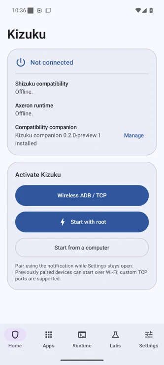
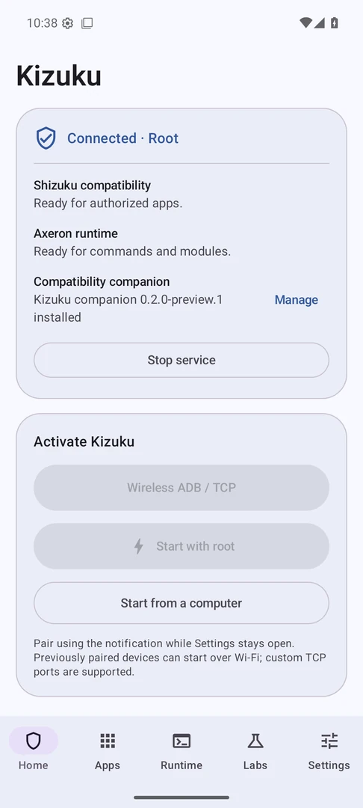

<p align="center">
  
</p>

<h1 align="center">Kizuku</h1>

<p align="center">
  Give compatible apps Shizuku access, run scripts and modules with Axeron,
  and control permissions from one Android app.
</p>

<p align="center">
  <strong><a href="https://github.com/stupidgiraffe/Kizuku/releases/download/v0.2.0-preview.1/Kizuku-v0.2.0-preview.1.apk">Download the signed APK ↓</a></strong>
  &nbsp;·&nbsp;
  <a href="https://github.com/stupidgiraffe/Kizuku/releases/tag/v0.2.0-preview.1">Release notes</a>
  &nbsp;·&nbsp;
  <a href="#quick-start">Quick start</a>
</p>

<p align="center"><strong>0.2.0 Preview 1</strong> · Android 8+ · Open source under Apache 2.0</p>

## What you can do

| Feature | What it gives you |
| --- | --- |
| **Shizuku compatibility** | Connect compatible apps using the bundled companion. Supports stock SDK discovery, UserService, process streams, and the stock `rish` launcher. |
| **Axeron runtime** | Run commands and scripts, save commands for later, and install compatible ZIP modules with actions, service scripts, and local WebUIs. Axeron access has its own permission. |
| **App controls** | Search and filter clients, remember or revoke individual grants, and review which apps will be affected before bulk Shizuku changes. Enable or disable installed apps for the primary Android user with the runtime active. |
| **Startup and recovery** | Start with Wireless ADB, a saved pairing key, local TCP, computer ADB, or root. Check service health in Service Doctor and pause client access with Safe Mode. |
| **System tools** | Edit system settings, inspect installed accessibility services, and enable optional device authentication for sensitive actions. |

## A look inside

<p align="center">
  
  &nbsp;
  
</p>

<p align="center"><sub>Startup and connected views from the signed release.</sub></p>

## Quick start

1. **Install the signed APK.** If the direct link hangs in your chat app, open the [release page](https://github.com/stupidgiraffe/Kizuku/releases/tag/v0.2.0-preview.1) in Chrome and tap the APK under **Assets**.
2. **Start Kizuku.** For wireless startup without root, open **Home → Wireless ADB / TCP → Pair with code**, then choose **Pair device with pairing code** in Android’s Wireless debugging settings. Enter the code through Kizuku’s notification while Settings stays open. Use **Start paired device** next time. Wireless debugging requires Android 11 or later. Home also has **Start with root** and **Start from a computer**.
3. **Connect your apps.** For Shizuku clients, install the companion in **Settings → Compatibility companion**. If stock Shizuku or a fork already owns the companion package, remove that conflicting app before installing the companion. Approve access in Kizuku when your client asks, or manage grants in **Apps**.
4. **Run your tools.** Open **Runtime** for commands and modules. To use a terminal, choose **Export rish ZIP** in **Settings** and approve Shizuku access for the terminal app.

## Release verification

The signed preview passed Android 16 and 17 emulator tests as shell and root, including an in-place upgrade from 0.1.0 Preview 2 that preserved remembered Shizuku access. Physical-device and OEM behavior, broader client and module compatibility, interactive Axeron PTY, and parts of the Axeron WebUI API are still being tested or developed. [Signed test run](https://github.com/stupidgiraffe/Kizuku/actions/runs/43200546463) · [APK checksum](https://github.com/stupidgiraffe/Kizuku/releases/download/v0.2.0-preview.1/SHA256SUMS.txt) · [Current status](docs/STATUS.md)

## Support development

If Kizuku makes your Android setup easier, you can help fund maintenance and device testing.

<p align="center">
  <a href="https://buymeacoffee.com/stupidgiraffe"></a>
  <br>
  <strong><a href="https://buymeacoffee.com/stupidgiraffe">☕ Buy me a coffee</a></strong>
</p>

## Source and credits

Kizuku is an independent open-source project built around the Shizuku and Axeron interfaces. [License](LICENSE) · [Upstream credits](NOTICE) · [Architecture](docs/ARCHITECTURE.md) · [Signing and security](SECURITY.md) · [Report an issue](https://github.com/stupidgiraffe/Kizuku/issues)

<details>
<summary>Build from source</summary>

Use JDK 21, Android SDK 37.0, Build Tools 37.0.0, NDK 29.0.14206865, and CMake 3.31.6.

```sh
./gradlew :core:test :manager:assembleDebug :test-client:assembleDebug :manager:lintDebug :test-client:lintDebug :compat:lintDebug
```

The debug APK is at `manager/build/outputs/apk/debug/manager-debug.apk`.

</details>
